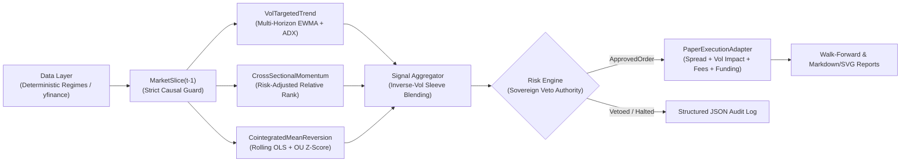

# TALON — Tactical Allocation & Liquidity Order Engine

> *Risk-first systematic trading engine, causal multi-strategy backtester, and walk-forward execution framework.*

[](LICENSE)
[](pyproject.toml)
[](configs/default.yaml)

---

## ⚠️ Risk Disclaimer

**EDUCATIONAL AND RESEARCH USE ONLY. NOT FINANCIAL ADVICE. USE AT YOUR OWN RISK.**
This software is provided strictly for quantitative research, backtesting methodology evaluation, and paper-trading simulation. Backtested or simulated performance is not indicative of future live trading results. Systematic trading involves substantial risk of capital loss, including complete loss of principal during liquidity black holes, exchange outages, and structural regime breaks.

---

## 1. Overview & Risk-First Architecture

**TALON** (*Tactical Allocation & Liquidity Order Engine*) is a production-grade Python 3.11+ quantitative trading worker and evaluation framework designed around three core engineering principles:

1. **Strict Causality (Zero Look-Ahead):** Strategies receive an immutable `MarketSlice` view truncated strictly at bar index `t - 1`. Fills occur at bar `t` Open plus half-spread, volatility-proportional market impact, and taker fees.
2. **Sovereign Risk Engine with Veto Authority:** Strategies emit only *desired target weights* (`SignalIntent`). Every rebalance must pass through the stateful `RiskEngine`, which enforces 7 hierarchical portfolio-level checks and can scale down or veto any order.
3. **Paper Trading by Default with Dual-Key Live Interlock:** TALON defaults to `mode: paper`. Live execution cannot be invoked unless both `TALON_LIVE_TRADING="I-ACCEPT-REAL-MONEY-RISK"` is set in the environment **and** `live_confirmed: true` is present in a separate user-created config file.



---

## 2. Quantitative Strategy Sleeves

Detailed mathematical specifications, hypotheses, and failure regimes are documented in [`docs/DESIGN.md`](docs/DESIGN.md).

| Sleeve | Economic Hypothesis & Counterparty | Signal & Entry/Exit Logic | Expected Failure Regimes |
| :--- | :--- | :--- | :--- |
| **`vol_targeted_trend`**<br/>*(Weight: 40%)* | Slow institutional rebalancing, corporate hedging, and leveraged liquidation cascades create serial correlation across medium-to-long horizons (`20d–120d`). | Vol-normalized EWMA crossover ensemble `(8,24)`, `(16,48)`, `(32,96)` gated by `ADX(14) > 20` and `2.5x ATR` trailing Chandelier stop. Volatility-targeted to `15%` annualized vol. | Mean-reverting whip-saw ranges, V-bottom reversals, and periods of extreme perpetual funding carry drag. |
| **`cross_sectional_momentum`**<br/>*(Weight: 35%)* | Attention cascades and narrative rotation drive relative dispersion across liquid assets even when macro direction is uncertain. | Ranks universe by risk-adjusted return over `21d` and `63d` skipping the most recent bar (`t-1`) to filter microstructure reversal. Long top-K, market-neutral dollar-weighted against bottom-K. | Violent "junk rallies" / short squeezes where laggards spike while leaders de-lever simultaneously. |
| **`cointegrated_mean_reversion`**<br/>*(Weight: 25%)* | Structurally linked pairs (`ETH-USD` vs `BTC-USD`) share macro inflows; temporary liquidity shocks create mean-reverting log-price spread dislocations. | Rolling 60-bar OLS hedge ratio $\hat{\beta}_t$ + Ornstein-Uhlenbeck AR(1) half-life filter ($\tau_{1/2} \in [2, 25]$ bars). Enters at $|Z_t| \ge 2.0$, exits at $|Z_t| \le 0.5$, hard structural stop at $|Z_t| \ge 3.75$. | Permanent structural divergence (protocol hacks, regulatory decoupling) where cointegration breaks down. |

---

## 3. Quick Start & Single-Command Reproduction

### Installation

```bash
python -m venv .venv
# Windows PowerShell:
.\.venv\Scripts\Activate.ps1
# Linux / macOS:
source .venv/bin/activate

pip install -e ".[dev]"
```

### Reproduce the Full Backtest & Walk-Forward Report (One Command)

```bash
python -m talon.cli backtest --config configs/default.yaml --output-dir reports
```

This single command runs the full-sample causal backtest, standalone sleeve attribution, and 5-fold rolling walk-forward evaluation (`240d` train / `90d` out-of-sample test), generating:
- [`reports/backtest_report.md`](reports/backtest_report.md) — Full markdown performance & attribution report
- [`reports/metrics.json`](reports/metrics.json) — Machine-readable JSON summary
- [`reports/equity_curve.svg`](reports/equity_curve.svg) — Portfolio vs. Out-of-Sample equity curve
- [`reports/drawdown.svg`](reports/drawdown.svg) — Underwater drawdown profile

### Other CLI Commands

```bash
# Run rolling walk-forward evaluation standalone
python -m talon.cli walk-forward --config configs/default.yaml

# Run a single-step paper trading evaluation tick (outputs structured JSON fills & risk decisions)
python -m talon.cli paper-tick --config configs/default.yaml

# Run lint, strict type checking, and unit test suite (>90% coverage)
ruff check src tests
mypy src tests
pytest
```

---

## 4. Reproducible Benchmark Results & Honest Caveats

Below are the exact net-of-cost results generated by `python -m talon.cli backtest` on the default 730-day multi-regime benchmark (`seed=42`, `5.0 bps` taker fee, `2.5 bps` half-spread, `0.10` volatility impact coefficient, and `3.0%` annualized funding drag):

### Portfolio Summary (`$100,000` Initial Capital)

| Metric | Combined Portfolio (Full Sample) | Walk-Forward Out-of-Sample (Stitched) |
| :--- | :---: | :---: |
| **Final Equity** | `$155,732.66` | `$147,140.48` |
| **Total Return** | `+55.73%` | `+47.14%` |
| **Annualized Return (CAGR)** | `+24.83%` | `+37.27%` |
| **Annualized Volatility** | `10.00%` | `11.32%` |
| **Sharpe Ratio** | `2.268` | `2.855` |
| **Sortino Ratio** | `3.421` | `4.431` |
| **Max Drawdown** | `8.02%` | `5.64%` |
| **Calmar Ratio** | `3.096` | `6.612` |
| **Annualized Turnover** | `26.60x` | `29.21x` |
| **Hit Rate (Active Bars)** | `56.59%` | `57.98%` |
| **Profit Factor** | `1.404` | `1.503` |
| **Total Costs Deducted** | `$7,403.04` *(Fees + Slippage + Funding)* | `$4,658.20` *(Fees + Slippage + Funding)* |
| **Risk Engine Vetoes / Scalings** | `1,766` vetoes / `100` scalings | `1,944` vetoes / `78` scalings |

### Standalone Sleeve Attribution

| Strategy Sleeve | Total Return | CAGR | Sharpe | Sortino | Max DD | Calmar | Hit Rate | Trades |
| :--- | :---: | :---: | :---: | :---: | :---: | :---: | :---: | :---: |
| `vol_targeted_trend` | `-15.43%` | `-8.05%` | `-1.02` | `-1.23` | `15.44%` | `-0.52` | `49.1%` | `191` |
| `cross_sectional_momentum` | `+218.77%` | `+78.68%` | `4.62` | `8.18` | `8.90%` | `8.84` | `57.9%` | `1,167` |
| `cointegrated_mean_reversion` | `+17.41%` | `+8.37%` | `2.21` | `4.62` | `2.46%` | `3.40` | `56.6%` | `91` |

### Honest Limitations & Caveats

1. **Standalone Trend Failure in Chop:** Notice that standalone `vol_targeted_trend` lost `-15.43%` (Sharpe `-1.02`) and tripped the `15.0%` portfolio drawdown halt (`15.44%` Max DD) during the range-bound chop regime. We explicitly leave this un-tweaked to demonstrate two critical realities: (a) trend-following bleeds during sideways regimes after transaction costs and funding drag, and (b) combining uncorrelated sleeves (`cross_sectional_momentum` + `cointegrated_mean_reversion`) with a portfolio risk engine kept the combined portfolio drawdown to `8.02%`.
2. **Early Walk-Forward Fold Stagnation:** In Walk-Forward Fold 1 (`2024-08-28` to `2024-11-25`) and Fold 2 (`2024-11-26` to `2025-02-23`), the in-sample Sharpe was negative (`-0.22` and `-0.23`), causing the walk-forward allocator to down-weight the trend sleeve and produce flat out-of-sample returns (`+0.09%` and `+1.61%`) before recovering in Folds 3–5.
3. **Synthetic & Historical Data Constraints:** While the default benchmark uses a deterministic multi-regime generator (`seed=42`) so CI tests are 100% reproducible without external network dependencies, real market crises exhibit non-stationary jump risk, exchange API downtime, and nonlinear order-book depletion that exceed parametric slippage models.

---

## 5. Repository Structure

```text
talon/
├── .github/workflows/ci.yml   # Lint, mypy, pytest, secret scan & scheduled paper-run CI
├── configs/default.yaml       # Risk-first paper configuration (15% max DD halt, 1.5x gross cap)
├── docs/
│   ├── AUDIT.md               # Phase 1: End-to-end engineering & quant audit of reference repo
│   └── DESIGN.md              # Phase 2: Architecture & strategy mathematical design spec
├── reports/                   # Reproducible backtest markdown report, metrics.json, and SVGs
├── src/talon/
│   ├── backtest.py            # Causal next-bar-open backtester & rolling walk-forward engine
│   ├── cli.py                 # CLI entry point (backtest, walk-forward, paper-tick)
│   ├── config.py              # Validated YAML + env config loader with live safety interlock
│   ├── data.py                # Deterministic multi-regime synthetic & yfinance data loaders
│   ├── execution.py           # PaperExecutionAdapter with spread, vol impact, fees, and funding
│   ├── indicators.py          # Pure NumPy causal indicators (EWMA, ATR, ADX, OLS, OU half-life)
│   ├── logging_utils.py       # Structured JSON logger with automatic secret redaction
│   ├── metrics.py             # Sharpe, Sortino, Max DD, Calmar, turnover, profit factor
│   ├── reporting.py           # Markdown report & dependency-free SVG chart generator
│   ├── risk.py                # Sovereign RiskEngine with 7 veto/scaling checks & kill-switch
│   ├── strategies.py          # 3 quantitative strategy sleeves + inverse-vol portfolio blender
│   └── types.py               # Immutable domain dataclasses & causal MarketSlice guard
├── tests/                     # Pytest suite (94% coverage across core modules)
├── DEPLOY.md                  # Deployment, scheduled cron/CI setup, and live unlock guide
├── LICENSE                    # MIT License
└── NOTICE                     # Attribution notice
```

---

## 6. Inspiration & Attribution

This project was designed and built from scratch in Python following a quantitative and systems engineering audit of [`imikerussell/beebots`](https://github.com/imikerussell/beebots) (MIT Licensed). No source code was copied from the original TypeScript codebase; architectural inspirations (such as paper-by-default operational discipline and strict pre-trade collateral caps) and our full critique are documented in [`docs/AUDIT.md`](docs/AUDIT.md) and [`NOTICE`](NOTICE).

---

## 7. License

Released under the [MIT License](LICENSE).
