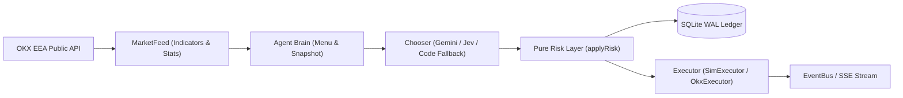

# Quantitative & Systems Engineering Audit

**Target Repository:** External Open-Source AI Perpetual Futures Engine (by Mike Russell, 2026)  
**License Verified:** MIT License (Permissive)  
**Auditor Role:** Senior Quantitative Trader & Systems Programmer  
**Date:** October 2026  

---

## Executive Summary

The audited repository is a TypeScript/Node.js real-time trading application designed to pit three AI-assisted agents against one another on OKX European Economic Area (EEA) perpetual futures (`_UM_XPERP-`). Originally built as an entertainment and educational showcase for a video creator channel ("Creator Magic"), it combines deterministic technical indicator menus with an LLM chooser layer (Google Gemini 4 Argon or TypeSafe Jev), wrapped around a deterministic risk-management gate and a real-time Server-Sent Events (SSE) React dashboard.

From a **software engineering and security operations** standpoint, the repository is surprisingly well-crafted. Its state management, SQLite WAL persistence, worst-case token spend reservation, log redaction, and password-gated endpoints are cleaner than 90% of retail open-source trading bots. 

From a **quantitative trading and empirical research** standpoint, however, the system suffers from a fatal flaw: **there is no backtesting engine, no historical simulation pipeline, no walk-forward validation, and zero out-of-sample verification in the codebase.** Strategies were adapted from blog posts, SSRN abstracts, and retail community repositories by changing bar timeframes (e.g., 1-day bars to 4-hour bars, 1-hour bars to 15-minute bars), adding arbitrary threshold filters, and inserting an LLM in the middle of execution without proving that the LLM adds positive expected value over the deterministic menu.

---

## 1. Architecture

### 1.1 Components & Stack
- **Runtime & Language:** Node.js (`>=22.13`) with native `node:sqlite` (`DatabaseSync` in WAL mode), written in strict TypeScript (`^5.8.0`).
- **Frontend:** React + Vite SPA (`dashboard/`) served behind a non-root Caddy reverse proxy (`Caddyfile`, `docker-compose.yml`).
- **Core Modules:**
  - `src/okx/rest.ts` & `src/okx/public.ts`: In-process public REST client with token-bucket rate limiting (`OKX_PUBLIC_LIMITS`), request deduplication, and TTL caching.
  - `src/okx/cli.ts`: Subprocess wrapper around `@okx_ai/okx-trade-cli` for authenticated endpoints (placing orders, querying positions, reading funding bills).
  - `src/market/data.ts` & `src/market/indicators.ts`: Polls 15m, 1H, and 4H candles, open interest, and funding rates; computes Wilder RSI, EMA, MACD, Wilder ATR, Bollinger Bands, realized volatility, and a 9-slice Donchian ensemble.
  - `src/jev.ts`: Decision router supporting Gemini 4 Argon (`generateContent` with structured JSON schema), TypeSafe AI (`@typesafe-ai/sdk`), and a deterministic priority-based fallback (`fallbackDecide`).
  - `src/risk.ts`: Pure functional risk filter (`applyRisk`) that checks account caps, stops, spread gates, funding vetoes, and margin sizing before emitting an executable `Action`.
  - `src/engine.ts`: Event loop orchestrator managing two primary timers: the decision tick (`TICK_MS`, default 10s) and an independent deterministic exit watch (`exitWatch`, 2s) guarded by per-agent asynchronous locks and epoch counters (`exitEpoch`).
  - `src/keeper.ts` & `src/lab/door.ts`: External webhook integration ("The Coach") allowing a scheduled Zapier workflow (using Claude Opus) to hot-swap natural language prompt rules and coin whitelists via HMAC-SHA256 authenticated requests.

### 1.2 Data Flow

---

## 2. Strategies Implemented

The repository implements three distinct agent archetypes, each operating on isolated capital ($333 default paper equity per slot, max 2x leverage):

### 2.1 Archetype 1: Intraday Mean-Reversion & Volatility Breakout (`bizzy.ts`)
- **Instruments:** Top 8 liquid crypto X-Perps (`BTC`, `ETH`, `SOL`, `HYPE`, `XRP`, `SUI`, `DOGE`, `LINK`) filtered by 24h volume and a $\le 5\text{ bps}$ spread gate.
- **Signal Logic:**
  1. *Bollinger + RSI Fade (15m bars):* Long when $\text{RSI}(14) < 30$ and Bollinger $\%B < 0$; Short when $\text{RSI}(14) > 70$ and $\%B > 1$. Vetoed if 30-day funding rate z-score exceeds $\pm 1.5$.
  2. *Larry Williams Daily Volatility Breakout (1h bars):* Long on `BTC`, `ETH`, `SOL`, or `HYPE` when price crosses $\text{DayOpen} + 0.5 \times \text{PrevDayRange}$, with $\text{Ret}_{1\text{h}} \ge 0$, $\text{RSI}(14) \le 78$, and $\text{FundingZ} \le 1.5$.
- **Exits & Parameters:** Target at Bollinger mid-band or $+1R$; discretionary cut-loss unlocked after 20 minutes (or immediately at $-0.5R$); hard stop at $2 \times \text{ATR}_{15\text{m}}$; ratcheting profit lock ($+1.2\%$ keeps $50\%$, $+2.5\%$ keeps $70\%$); 4-hour time stop. Max 4 trades/day, 30m cooldown.

### 2.2 Archetype 2: Ensemble Donchian Trend Following (`breezy.ts`)
- **Instruments:** `BTC` and `ETH` perpetuals only ($\le 5\text{ bps}$ spread gate).
- **Signal Logic:**
  - Adapts Zarattini, Pagani & Barbon (2025) 9-lookback Donchian ensemble ($L \in \{5, 10, 20, 30, 60, 90, 150, 250, 360\}$) from daily bars to **4-hour bars**, and adds a mirrored short side.
  - Each lookback slice turns $+1$ (long) above the prior $L$-bar high close, or $-1$ (short) below the prior $L$-bar low close, trailing at the channel midpoint.
  - Enters when $|\text{score}| \ge 3$ out of 9 slices and 24h return does not oppose the trend (unless $|\text{score}| \ge 5$).
- **Exits & Parameters:** Hard stop at $2 \times \text{ATR}_{4\text{h}}$, trailing with the average active Donchian channel midpoint; profit lock ($+2\%$ keeps $45\%$, $+4\%$ keeps $65\%$); trims 50% if score drops by $\ge 3$ points; exits when score turns $\le 0$. Max 2 trades/day, 4h cooldown.

### 2.3 Archetype 3: Short-Horizon Impulse Momentum (`boozy.ts`)
- **Instruments:** Any live crypto X-Perp with 24h volume $\ge \$15\text{M}$ and spread $\le 8\text{ bps}$.
- **Signal Logic:**
  - Ranks candidates hourly by a composite z-score: $0.45 \cdot Z(|\text{Ret}_{24\text{h}}|) + 0.35 \cdot Z(|\text{Ret}_{1\text{h}}|) + 0.20 \cdot Z(|\text{Ret}_{7\text{d}}|) + 0.25 \cdot \max(0, \text{AttentionZ}) + 0.5 \cdot \mathbb{I}(\text{Impulse})$.
  - *Long Impulse:* $\text{Ret}_{24\text{h}} \ge +1.5\%$, $\text{Ret}_{1\text{h}} \ge 0\%$, $\Delta\text{OI}_{1\text{h}} \ge 0\%$, $\text{RSI}(14) \le 78$, $\text{FundingZ} \le 1.5$.
  - *Short Breakdown:* $\text{Ret}_{24\text{h}} \le -1.5\%$, $\text{Ret}_{1\text{h}} < 0\%$, $\text{RSI}(14) \ge 22$.
- **Exits & Parameters:** Enters at $1\times$ equity; allows one $+0.5\times$ pyramid add after a $+1.5 \times \text{ATR}_{1\text{h}}$ favorable move (moving stop to new average entry); unlocks discretionary bail/switch after 30 minutes; hard stop at $2.5 \times \text{ATR}_{1\text{h}}$, trailing at $2.0 \times \text{ATR}_{1\text{h}}$; 12-hour time stop. Max 3 trades/day, 60m cooldown.

---

## 3. Risk Management

The risk engine (`src/risk.ts`) is the strongest module in the audited repository. Key characteristics:
1. **Strict Separation of Concerns:** The AI model never sees order endpoints or sizing parameters; it selects a semantic label from a pre-validated menu (`FADE_LONG_ETH`, `HOLD`, `TRIM_HALF`). Plain deterministic code computes contract quantities and can veto or override any choice.
2. **Position Sizing & Margin Headroom:** Caps notional exposure at `min(MAX_LEVERAGE * equity * 0.97, maxNotionalUsdPerSlot)`, where `MAX_LEVERAGE` is hard-capped at `2.0` (`config.ts` throws on startup if `> 2`). The `0.97` factor (`MARGIN_HEADROOM`) prevents exchange insufficient-margin rejections caused by taker fees.
3. **Realized-Cash Collateral Guard:** Pyramiding and rebalancing adds (`breezy.ts`, `boozy.ts`, `risk.ts`) compute available room against `min(equityUsd, cashUsd)` rather than mark-to-market equity, preventing unbooked unrealized PnL from inflating leverage.
4. **Hard Stops & Kill Switches:**
   - **Per-Trade Stop:** Initial ATR stop + ratcheting trail + stepped profit-lock rungs, checked every 2 seconds by an independent `exitWatch()` loop so a slow LLM call never delays a stop-loss.
   - **Daily Loss Stop:** 8% intraday equity drawdown (`DAILY_LOSS_STOP_PCT=8`) flattens the agent and benches it until 00:00 UTC.
   - **Permanent Retirement:** 60% cumulative drawdown (`40%` remaining of starting equity) permanently halts the agent.
   - **Churn & Fee Caps:** Per-agent daily trade count limits (2–4 trades/day) and daily USD fee budgets ($0.75–$1.50/day).
   - **Live Ramp & Safety Latch:** Defaults to `DRY_RUN=true` and `MODE=dry`. Switching to live requires `DRY_RUN=false`, `MODE=live`, 9 environment variables for 3 sub-account keys, and `LIVE_ACK=I-ACCEPT-REAL-MONEY-RISK`, plus scales down position sizes to 25% for the first 2 hours.

**Risk Flaws Identified:**
- **Zero Cross-Agent Portfolio Risk:** Each agent runs in its own silo. All three agents can simultaneously go long `BTC` or highly correlated altcoins (`SOL`, `ETH`, `SUI`) at 1x–2x leverage. Since crypto correlations spike toward $1.0$ during liquidations, the portfolio has no cross-sectional beta cap or correlation limit.
- **Mid-Price Stop Triggering:** Stops in `risk.ts` trigger when `s.mid <= p.stopPx`, and in `SimExecutor` they execute at the current bid/ask without modeling stop-market cascade slippage through thin order books.

---

## 4. Execution Realism

- **Order Types:** 100% market orders (`--ordType market`, `--tdMode isolated`, `--reduceOnly` on closes). Resting limit orders were intentionally excluded to avoid self-trade prevention (STP) across sub-accounts.
- **Fee & Spread Modeling:** In `SimExecutor` (`MODE=dry`), buys fill at `t.ask` and sells fill at `t.bid` (capturing top-of-book half-spread) plus a flat `0.05%` (5 bps) taker fee, and funding is charged/credited at 00:00, 08:00, and 16:00 UTC.
- **Execution Flaws:**
  1. **Subprocess Overhead on Live Orders:** While public market data was migrated in-process (`src/okx/rest.ts`), private order execution (`src/okx/cli.ts`) still spawns a full Node.js child process (`execFile(process.execPath, [CLI_JS, ...])`) per command, followed by a polling loop (`futures get`) up to 12 times at 300ms+ intervals. Spawning a Node.js VM to send a market order adds 150–400ms of local latency before the packet even leaves the machine.
  2. **Zero Depth/Market Impact Modeling in Simulation:** `SimExecutor` fills any notional size at the top-of-book `bid`/`ask` regardless of order book depth (`bidSz`/`askSz`).
  3. **Partial Fill Naive Handling:** In `OkxExecutor.market()`, if an order is still partially filling or unconfirmed after 12 poll attempts, it returns `state: "unknown"`, pausing new orders for 10 minutes until the 5-minute reconciliation loop settles the state.

---

## 5. Backtesting Rigor

**Score: Non-existent (1/10).**

There is **no backtester** in the repository. A thorough inspection of `src/` and `test/` reveals:
- **Zero Historical Replay:** `test/e2e-dry.harness.ts` runs against live market data for a few seconds with a random number generator (`Math.random()`). There is no module to ingest historical OHLCV + funding series and simulate strategy performance over months or years.
- **Unvalidated Timeframe Mutations:**
  - In the trend strategy documentation (`strategies/`), the author cites Zarattini et al. (2025) on *daily* bars (lookbacks up to 360 days), then writes: *"Our adaptation (inference, not from the paper): 4-hour bars instead of daily, so a 30-day video has action. Lookbacks become bar counts. A mirrored short side..."* Compressing lookbacks by $6\times$ (60 days max instead of 360 days) and adding symmetric shorting on positively skewed crypto assets fundamentally alters the statistical properties of the strategy without a single backtest to verify whether the edge survives.
  - Furthermore, `MarketFeed.refresh()` fetches `this.api.candles(id, "4H", 300)`—only **300 bars**! Yet `DONCHIAN_LOOKBACKS` includes `360`. Because $300 < 360 + 1$, the 360-bar slice in `donchianEnsemble()` is **permanently dead code** in production (`slicesAvailable` is at most 8, never 9), while `breezySizeFrac` still divides `Math.abs(s.trend.score) / 9`, permanently under-sizing the strategy by $11.1\%$!
- **Look-Ahead / Intra-Bar Bias in Indicators:** `MarketFeed.refresh()` calls `this.api.candles(id, "15m", 100)` and passes the array directly to `rsi()`, `bollinger()`, `atr()`, and `donchianEnsemble()`. OKX's `/api/v5/market/candles` includes the **unconfirmed, currently forming bar** as the newest element (`confirmed: false`). While `computeStats()` filters `c1h.filter(c => c.confirmed)` for volume z-scores, it uses **unconfirmed candles** for RSI, Bollinger Bands, ATR, and 4h Donchian breakouts! This causes intrabar signal flickering—an agent can trigger a "confirmed" 4h Donchian close breakout 10 minutes into a 4-hour bar on a transient wick that reverses before the bar closes.
- **Ad-Hoc Post-Mortem Overfitting:** Commit history and release notes (`v2026.10.14`) show that after the initial rules lost money on 37 of 58 forced trades over 2 weeks, an LLM ("Gemini 4 Argon") was asked to rewrite the strategy parameters (`BIZZY_PROFIT_LOCK`, `BOOZY_MIN_VOL_USD = 15_000_000`, `BOOZY_MIN_HOLD_MIN = 30`, etc.) based on that tiny 2-week sample. Fitting multi-parameter rules to 58 trades is textbook small-sample overfitting.

---

## 6. Code Quality & Security

- **Testing (`test/*.test.ts`):** 23 Vitest suites testing risk gates, indicator math, redaction, database schemas, and HMAC signatures. Tests are fast, deterministic, and well-structured.
- **Typing & Linting:** Strict TypeScript (`noImplicitAny`, `strictNullChecks`), Zod runtime schema validation on all external inputs (`.env`, `settings.json`, HTTP bodies, leaderboard responses).
- **Security & Secrets Management:**
  - `src/redact.ts` scrubs API keys, Bearer tokens, UUIDs, hex blobs, emails, and IPv4/IPv6 addresses from all logs and SSE payloads.
  - Passwords use `scrypt` (`N=32768, r=8, p=1`) with `timingSafeEqual` and brute-force lockout (`gate.ts`).
  - Webhook overlays (`lab/door.ts`) use HMAC-SHA256 with timestamp windowing and replay caches, and prevent prompt/rule injection from altering risk parameters.
  - Setup endpoint has a 2-hour timeout window (`SETUP_WINDOW_MIN`) and per-IP rate limits.

---

## 7. Quantitative & Engineering Scorecard

| Category | Score (1–10) | Justification |
| :--- | :---: | :--- |
| **Strategy Edge** | **3 / 10** | Uses reasonable academic building blocks (Donchian trend, funding filter), but destroys them with unvalidated timeframe compression, unconfirmed intrabar candle signals, dead 360-bar lookback bug, and an unproven LLM decision layer. |
| **Risk Management** | **7 / 10** | Strong per-agent guardrails (2x max leverage, 0.97 margin headroom, realized-cash add cap, 2s independent stop watcher, daily loss & retire stops). Docked 3 points for zero portfolio-level correlation/beta controls across slots and mid-price stop assumptions. |
| **Execution** | **5 / 10** | Good spread gates and top-of-book + taker fee + funding paper simulation. Docked for spawning child processes per live order, market-order-only execution, and zero order-book depth/slippage impact modeling. |
| **Engineering** | **8.5 / 10** | Clean TypeScript, zero global state, dependency injection, SQLite WAL durability, worst-case API spend reservation, comprehensive redaction, and thorough unit tests. |
| **Documentation** | **8 / 10** | Clear operational docs, transparent cost math (`docs/COSTS.md`), explicit risk disclaimers, and honest admissions of past losing streaks. Lacks quantitative validation reports. |

---

## 8. Brutally Honest Verdict

1. **What is genuinely good:** The systems engineering, operational safety, and risk architecture ("LLM chooses from a menu, deterministic code decides and sizes") are top-tier. The author treated real-money safety latches, API spend caps, secret redaction, and crash recovery with genuine discipline.
2. **What is deeply flawed:** There is no quantitative research pipeline. Modifying academic daily strategies into 15-minute and 4-hour leveraged perp strategies without a backtester or walk-forward validator is flying blind. Feeding unconfirmed intrabar candles into close-based indicators (`donchianEnsemble`, `rsi`, `bollinger`) introduces severe intrabar noise, and requesting 300 bars for a 360-bar indicator (`breezy.ts`) is a silent logic bug that went unnoticed because no historical backtest was ever run.
3. **What is marketing/entertainment fluff:** The entire LLM chooser and external "coach" layer. Once deterministic code filters the universe and constructs a menu of 1 to 3 valid setups, paying an LLM (or chaining Zapier + Claude Opus) to pick from that menu based on a two-sentence personality prompt ("crooked party hat, manic grin") adds latency and token burn, not statistical alpha. It is great interactive entertainment for a live stream—and the author is refreshingly honest that entertainment was the goal—but as a systematic trading worker, deterministic statistical signals with rigorous walk-forward validation and portfolio-level risk management will beat an LLM roleplay prompt every day of the week.
