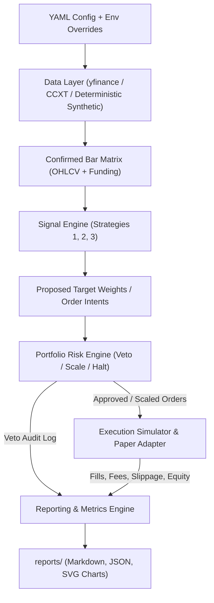

# TALON System Architecture & Strategy Design

**Project:** TALON (*Tactical Allocation & Liquidity Order Engine*)  
**Tagline:** *Risk-First Quantitative Trading Worker & Walk-Forward Simulation Engine*  

---

## 1. Design Philosophy (Informed by Audit)

Our audit of the reference repository (`docs/AUDIT.md`) revealed a stark dichotomy: excellent operational guardrails paired with a non-existent quantitative research pipeline, unconfirmed intrabar indicator pollution, silent lookback truncation bugs, and an unvalidated LLM chooser layer.

**TALON** is designed from the ground up to fix every structural weakness identified in the audit while preserving the strict paper-by-default operational safety model:

1. **Deterministic Statistical Signals over LLM Roleplay:** Every signal in TALON is mathematically defined, reproducible, and testable across years of historical data. No API spend is wasted asking a language model to pick from a menu.
2. **Confirmed-Bar Causal Discipline:** Signals are evaluated strictly on closed, confirmed bars ($t$). Orders generated from bar $t$ execute at bar $t+1$ open plus dynamic volatility-scaled slippage and exchange fees. Look-ahead bias is structurally impossible.
3. **Portfolio-Level Risk Engine with Veto Authority:** Instead of isolated silos that can simultaneously lever up on correlated assets, TALON's risk engine evaluates the **entire portfolio** before any order reaches execution: enforcing drawdown halts, daily loss limits, per-asset notional caps, gross leverage ceilings, and pairwise return correlation limits.
4. **First-Class Walk-Forward Validation:** Every strategy and portfolio configuration can be evaluated through rolling anchored or sliding In-Sample (IS) / Out-of-Sample (OOS) windows to quantify parameter stability and out-of-sample decay.

---

## 2. System Architecture

TALON enforces a strict, unidirectional pipeline with zero global state:

### 2.1 Component Responsibilities
- **Data Layer (`src/talon/data/`):** Fetches and normalizes multi-asset OHLCV bars from free public endpoints (`yfinance` for equities/crypto/ETFs, `ccxt` public REST for crypto spot/perps, or a deterministic multi-regime geometric Brownian motion / Ornstein-Uhlenbeck generator for offline reproducible CI testing). Validates monotonic timestamps, checks for missing bars, and guarantees enough warmup bars for the longest lookback.
- **Signal Engine (`src/talon/strategies/`):** Pure strategy implementations adhering to a typed `Strategy` interface. Receives a read-only slice of confirmed historical bars up to time $t$ and outputs `SignalIntent` objects containing raw conviction, target volatility weight, and stop price.
- **Risk Engine (`src/talon/risk/`):** Stateful portfolio gatekeeper with **absolute veto authority**. Inspects proposed intents against current portfolio equity, peak drawdown, daily PnL, asset volatility, pairwise correlation matrix, gross exposure, and trade turnover limits. Can approve, scale down, or outright veto any order, recording a structured `RiskDecision`.
- **Execution Simulator & Paper Adapter (`src/talon/execution/` & `src/talon/backtest/`):** Models realistic fills with configurable maker/taker fee bps, fixed spread bps, and volatility-proportional market impact slippage. Enforces paper-trading by default; live mode is locked behind dual safety gates (`TALON_LIVE_TRADING=I-ACCEPT-REAL-MONEY-RISK` + explicit live config file).
- **Walk-Forward & Reporting Engine (`src/talon/walkforward/` & `src/talon/reporting/`):** Runs full-sample and rolling walk-forward evaluations, computing Sharpe, Sortino, Max Drawdown, Calmar, Annualized Return/Vol, Turnover, Hit Rate, and Profit Factor, and outputs self-contained reports (`reports/backtest_report.md`, `reports/metrics.json`, `reports/equity_curve.svg`, `reports/drawdown.svg`).

---

## 3. Quantitative Strategies

TALON implements three complementary, low-correlation strategies designed to harvest distinct market structural premia across liquid instruments (`BTC-USD`, `ETH-USD`, `SOL-USD`, `AVAX-USD`, `LINK-USD`, or liquid macro ETFs).

### 3.1 Strategy 1: Volatility-Targeted Multi-Horizon Trend Following (`VolTargetedTrend`)

- **Hypothesis & Counterparty:**
  - *Why the edge exists:* Behavioral anchoring, institutional rebalancing delays, and leveraged liquidation cascades cause asset prices to exhibit positive serial autocorrelation at medium-to-long horizons (10 to 120 days).
  - *Who is on the other side:* Disposition-effect retail traders selling winners too early, and passive liquidity providers absorbing directional flow during macro regime shifts.
- **Signal Definition:**
  - Computes a multi-horizon ensemble across lookbacks $L \in \{10, 20, 40, 80, 120\}$ confirmed daily bars (fixing the audited repo's unconfirmed intrabar noise and truncated 360-bar bug).
  - For each lookback $L$, a sub-signal $s_L(t) \in \{-1, 0, +1\}$ turns $+1$ when $C_t > \max_{i=1..L} C_{t-i}$, turns $-1$ when $C_t < \min_{i=1..L} C_{t-i}$, and exits to $0$ when price crosses the ratcheting channel midpoint $M_L(t) = \frac{1}{2}(\max_{i=1..L} C_{t-i} + \min_{i=1..L} C_{t-i})$.
  - Composite signal strength:
    $$S_{\text{trend}}(t) = \frac{1}{|L|} \sum_{L} s_L(t) \in [-1, +1]$$
  - Activation threshold: $|S_{\text{trend}}(t)| \ge 0.40$ (at least 2 of 5 net slices aligned) to stay flat in sideways chop.
- **Position Sizing:**
  - Volatility-targeted weight using 30-day exponentially weighted realized volatility $\hat{\sigma}_i(t)$:
    $$w_i^{\text{raw}}(t) = S_{\text{trend}}(t) \cdot \frac{\sigma_{\text{target}}}{\hat{\sigma}_i(t)}$$
    where $\sigma_{\text{target}} = 0.20$ (20% annualized vol target per strategy sleeve), capped at $w_{\max} = 0.50$.
- **Stops & Exits:**
  - Hard Chandelier stop at $2.5 \times \text{ATR}_{14}(t)$ from peak favorable close, or when $|S_{\text{trend}}(t)| < 0.20$.
- **Expected Failure Regimes:**
  - Mean-reverting, range-bound markets ("whipsaw chop") where breakouts immediately fail before follow-through develops, and V-shaped flash crashes where volatility spikes faster than the 30-day estimator adapts.

---

### 3.2 Strategy 2: Cross-Sectional Volatility-Adjusted Momentum (`CrossSectionalMomentum`)

- **Hypothesis & Counterparty:**
  - *Why the edge exists:* Relative strength persists cross-sectionally across assets over 7-to-30 day horizons due to narrative rotation, capital inflows into sector leaders, and slow cross-asset diffusion of information. Dividing returns by realized volatility (information-ratio ranking) avoids simply buying the highest-beta lottery tickets (fixing the audited repo's noisy raw-return chasing).
  - *Who is on the other side:* Contrarian retail traders buying laggards ("it hasn't pumped yet") and fading relative leaders prematurely.
- **Signal Definition:**
  - For each asset $i$ in universe $U$ at rebalance period $t$, compute the risk-adjusted momentum score over lookback $K_{\text{fast}} = 7$ and $K_{\text{slow}} = 21$ bars, skipping the most recent 1 bar to mitigate microstructure reversal:
    $$R_i^{(K)}(t) = \frac{C_{t-1}}{C_{t-1-K}} - 1, \quad \text{IR}_i(t) = \frac{0.5 \cdot R_i^{(7)}(t) + 0.5 \cdot R_i^{(21)}(t)}{\hat{\sigma}_i(t)}$$
  - Cross-sectional z-score across the tradable universe:
    $$Z_i(t) = \frac{\text{IR}_i(t) - \mu_{\text{IR}}(t)}{\sigma_{\text{IR}}(t)}$$
  - Entry/Exit: Go long top-ranked assets with $Z_i(t) > +0.75$ and short bottom-ranked assets with $Z_i(t) < -0.75$ (market-neutral or beta-bounded). Exit when $|Z_i(t)| < 0.25$.
- **Position Sizing:**
  - Volatility-scaled proportional to $|Z_i(t)|$, normalized so total gross exposure of the cross-sectional sleeve does not exceed $0.60\times$ portfolio equity.
- **Expected Failure Regimes:**
  - Sharp factor reversals ("momentum crashes") typically occurring at market troughs when heavily shorted laggards experience violent short squeezes while crowded leaders deleverage.

---

### 3.3 Strategy 3: Ornstein-Uhlenbeck Statistical Arbitrage / Residual Mean Reversion (`CointegratedMeanReversion`)

- **Hypothesis & Counterparty:**
  - *Why the edge exists:* Economically linked assets (e.g., `ETH` vs. `BTC`, or `SOL` vs. an equal-weighted major basket) share common macro factors. Temporary liquidity shocks, ETF flow imbalances, or single-asset liquidations push their log-price spread away from equilibrium, which subsequently mean-reverts.
  - *Who is on the other side:* Uninformed market orders demanding immediate liquidity in a single leg, creating transient relative mispricings.
- **Signal Definition:**
  - Estimate rolling OLS hedge ratio $\beta(t)$ between log prices $y_t = \ln P_A(t)$ and $x_t = \ln P_B(t)$ over a $W = 60$-bar window:
    $$e_t = y_t - \left(\alpha(t) + \beta(t) x_t\right)$$
  - Compute the rolling spread z-score over window $M = 20$:
    $$z_{\text{spread}}(t) = \frac{e_t - \mu_e(t)}{\sigma_e(t)}$$
  - Estimate the discrete Ornstein-Uhlenbeck autoregression $\Delta e_t = \kappa (\theta - e_{t-1}) + \epsilon_t$ to derive the mean-reversion half-life $\tau_{1/2} = -\frac{\ln 2}{\ln(1 - \kappa)}$.
  - **Regime Filter:** Only trade when the estimated half-life is within a stationary tradable range $\tau_{1/2} \in [2, 25]$ bars. If $\tau_{1/2} > 25$ or $\kappa \le 0$ (structural break / non-stationary divergence), the strategy stays 100% flat.
  - **Entry/Exit:**
    - Enter Short Spread (short $A$, long $\beta B$) when $z_{\text{spread}}(t) > +2.0$.
    - Enter Long Spread (long $A$, short $\beta B$) when $z_{\text{spread}}(t) < -2.0$.
    - Take Profit when $|z_{\text{spread}}(t)| \le 0.35$.
    - Stop Loss (structural break bailout) when $|z_{\text{spread}}(t)| \ge 3.5$ or half-life exceeds $30$ bars.
- **Position Sizing:**
  - Capped fractional Kelly / volatility-targeted sizing targeting $12\%$ annualized spread volatility, capped at $0.40\times$ equity per leg.
- **Expected Failure Regimes:**
  - Permanent structural divergence (e.g., protocol exploit, regulatory action, or idiosyncratic re-rating on one leg of the pair) where the historical cointegration relationship breaks down permanently.

---

## 4. Portfolio Risk Engine Specification

The `RiskEngine` (`src/talon/risk/engine.py`) sits between the Signal Engine and the Execution Simulator. **No order can bypass it.** Every bar, it executes the following deterministic checks in strict priority order:

| Priority | Guardrail | Default Threshold | Action on Breach |
| :---: | :--- | :---: | :--- |
| **1** | **Max Drawdown Kill Switch** | $15.0\%$ peak-to-trough | **VETO ALL** new entries; generate immediate flatten orders for all open positions; lock portfolio in `HALTED_MAX_DD` state. |
| **2** | **Daily Loss Circuit Breaker** | $4.0\%$ intraday / daily loss | **VETO ALL** new entries and flatten open positions for the remainder of the UTC day (`HALTED_DAILY_LOSS`). |
| **3** | **Minimum Liquidity & Data Sanity** | $\text{Price} > 0$, $\text{Vol} > 0$, non-NaN | **VETO** order on invalid or stale market data (`STALE_OR_INVALID_DATA`). |
| **4** | **Per-Asset Exposure Cap** | $35.0\%$ of equity per asset | **SCALE DOWN** target weight so $|w_i| \le 0.35$ (`SCALED_ASSET_CAP`). |
| **5** | **Pairwise Correlation Limit** | $\rho_{ij} > 0.80$ (30-bar rolling) | If two same-direction positions have rolling return correlation $> 0.80$, cap their combined gross weight at $1.25 \times$ the single-asset cap (`SCALED_CORRELATION_LIMIT`). |
| **6** | **Portfolio Volatility Target** | $25.0\%$ annualized ex-ante vol | Compute ex-ante portfolio volatility $\sigma_p = \sqrt{\mathbf{w}^\top \boldsymbol{\Sigma} \mathbf{w}}$. If $\sigma_p > 0.25$, scale all weights uniformly by $0.25 / \sigma_p$ (`SCALED_PORTFOLIO_VOL`). |
| **7** | **Max Gross Leverage Ceiling** | $1.50\times$ total equity | If $\sum_i |w_i| > 1.50$, scale all weights proportionally (`SCALED_GROSS_LEVERAGE`). |
| **8** | **Minimum Trade Notional / Deadband** | $\Delta |w_i| < 2.0\%$ | **VETO** tiny rebalance adjustments below $2\%$ weight delta to prevent fee churn (`VETOED_REBALANCE_DEADBAND`). |
