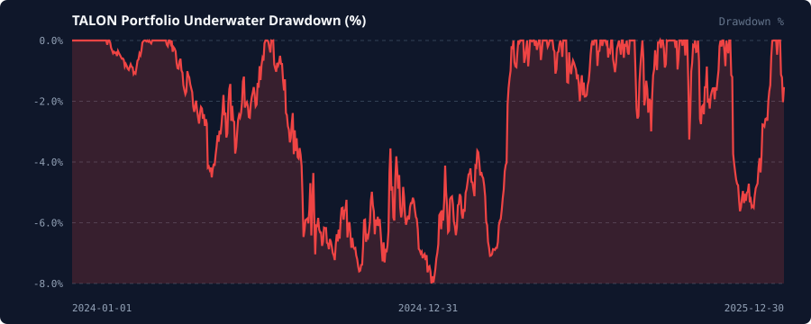

# TALON Reproducible Backtest & Walk-Forward Report

> **Disclaimer:** *Educational & research simulation only. Not financial advice. Past or simulated performance is not indicative of future results.*

---

## 1. Run Configuration Summary

- **Execution Mode:** `paper` (Paper / Simulation by default)
- **Data Source:** `synthetic` (Seed: `42`, Bars: `730`, Timeframe: `1d`)
- **Universe:** `BTC-USD, ETH-USD, SOL-USD, AVAX-USD, LINK-USD`
- **Transaction Cost Model:** `5.0 bps` taker fee + `2.5 bps` half-spread + `0.1` vol impact coeff + `3.0%` annualized funding drag
- **Risk Guardrails:** Max DD Halt `15.0%`, Daily Loss Limit `4.0%`, Asset Cap `35.0%`, Max Gross Leverage `1.50x`

---

## 2. Portfolio Full-Sample Performance (Net of All Costs)

| Metric | Combined Portfolio | Out-of-Sample (Walk-Forward Stitched) |
| :--- | :---: | :---: |
| **Initial Equity** | `$100,000.00` | `$100,000.00` |
| **Final Equity** | `$155,732.66` | `$147,140.48` |
| **Total Return** | `+55.73%` | `+47.14%` |
| **Annualized Return (CAGR)** | `+24.83%` | `+37.27%` |
| **Annualized Volatility** | `10.00%` | `11.32%` |
| **Sharpe Ratio** | `2.268` | `2.855` |
| **Sortino Ratio** | `3.421` | `4.431` |
| **Max Drawdown** | `8.02%` | `5.64%` |
| **Calmar Ratio** | `3.096` | `6.612` |
| **Annualized Turnover** | `26.60x` | `29.21x` |
| **Hit Rate (Active Bars)** | `56.59%` | `57.98%` |
| **Profit Factor** | `1.404` | `1.503` |
| **Total Executed Fills** | `1180` | `789` |
| **Total Exchange Fees** | `$2,975.99` | `$2,064.99` |
| **Total Slippage & Impact** | `$2,438.21` | `$1,690.02` |
| **Total Funding Drag** | `$1,988.84` | `$903.19` |
| **Risk Engine Vetoes** | `1766` | `1944` |
| **Risk Engine Scalings** | `100` | `78` |

---

## 3. Standalone Strategy Sleeve Attribution

| Strategy Sleeve | Total Return | CAGR | Sharpe | Sortino | Max DD | Calmar | Hit Rate | Trades |
| :--- | :---: | :---: | :---: | :---: | :---: | :---: | :---: | :---: |
| `vol_targeted_trend` | -15.43% | -8.05% | -1.02 | -1.23 | 15.44% | -0.52 | 49.1% | 191 |
| `cross_sectional_momentum` | +218.77% | +78.68% | 4.62 | 8.18 | 8.90% | 8.84 | 57.9% | 1167 |
| `cointegrated_mean_reversion` | +17.41% | +8.37% | 2.21 | 4.62 | 2.46% | 3.40 | 56.6% | 91 |

---

## 4. Walk-Forward Evaluation (`240`d Train / `90`d OOS Test)

- **Mean In-Sample Sharpe:** `1.659`
- **Mean Out-of-Sample Sharpe:** `2.891`
- **OOS / IS Sharpe Retention Ratio:** `1.743`

| Fold | Out-of-Sample Window | IS Sharpe | OOS Sharpe | OOS Return | OOS Max DD |
| :--- | :---: | :---: | :---: | :---: | :---: |
| Fold 1 | 2024-08-28 to 2024-11-25 | -0.22 | 0.09 | +0.09% | 3.39% |
| Fold 2 | 2024-11-26 to 2025-02-23 | -0.23 | 0.76 | +1.61% | 4.31% |
| Fold 3 | 2025-02-24 to 2025-05-24 | 0.51 | 6.77 | +18.64% | 2.61% |
| Fold 4 | 2025-05-25 to 2025-08-22 | 4.05 | 3.86 | +10.46% | 3.00% |
| Fold 5 | 2025-08-23 to 2025-11-20 | 4.18 | 2.97 | +10.40% | 5.64% |

---

## 5. Visual Artifacts

- Equity Curve: [`equity_curve.svg`](equity_curve.svg)
- Underwater Drawdown: [`drawdown.svg`](drawdown.svg)
- Machine-Readable Metrics: [`metrics.json`](metrics.json)

---

## 6. Honest Caveats & Limitations

1. **Synthetic / Historical Regime Dependency:** The default reproducible benchmark runs on a seeded multi-regime statistical process (`seed=42`) to ensure deterministic CI verification without external API flakiness. Real crypto and equity markets experience fat-tailed liquidity black holes, exchange outages, and structural correlation breaks that can exceed historical or parametric bounds.
2. **Funding & Borrow Variability:** While this backtest deducts a continuous `3.0%` annualized funding drag on open notional, real perpetual futures funding rates can spike to `>50%` annualized during crowded bull runs, eroding trend-following carry.
3. **Cointegration Breakdown Risk:** Statistical arbitrage pairs (`ETH-USD` vs `BTC-USD`) can undergo permanent structural divergence where the Ornstein-Uhlenbeck half-life filter triggers a stop-loss exit at a realized loss.
